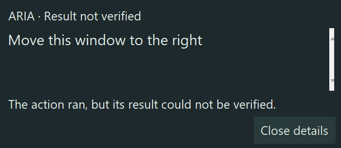

# Phase 8 — Seam native presentation implementation

Date: 2026-10-12. Branch: `phase8/shard-design`. **Presentation increment implemented; Phase 8 remains partially complete.**

## 1. Delivered and scope

Seam is a native Windows surface built with the installed Tkinter and Pillow stack. It has a small top-center dark material, a narrow luminous seam, restrained status geometry, a measured/ellipsized caption, and a separate selectable, scrolling transcript disclosure. Logical sizes: 124×23 ready; up to 218×26 active; 280-wide details, normally 122 high, 178 for long transcripts and 208 for confirmation. Actual pixels scale with monitor DPI and clamp to work area. The older HTML designs remain intact.

The standalone demo exposes all eleven states and clearly synthetic input/output activity. Its “Open Chrome” example sends events only; it never opens Chrome. A quick final/executing/verified batch renders the verified result directly. Processing/executing exposure waits 180 ms only in the visual projection, never in the source model or a command path. Important failures, confirmation and unverified results remain inspectable. Verified/cancelled compact feedback returns to ready while the authoritative snapshot and full transcript stay available until replacement/close.

Motion uses exact critically damped spring integration, retains velocity on retargeting and settles completely. Audio activity expires after 250 ms without another sample. Static artwork is cached in memory, with only the moving segment redrawn during activity. No frame animation runs when hidden or settled; a low-frequency event poll remains. Reduced motion retains text, icons and state geometry. Processing contracts the central segment; execution offsets it; verified contracts and adds a check; failure breaks the seam; confirmation uses end caps; unverified uses a smaller gap and question mark. Color is supplementary.

**Nothing connects to live activation, microphone, transcription, action execution, results, global hotkeys or permission grants.** Confirmation controls record a session/sequence-bound demo intent in memory, with no callback to the kernel. Speaking is an optional typed output envelope, independent of the command outcome; no speech engine or fabricated audio synchronization was added.

## 2. Files

Modified existing Phase 8 file:

- `src/aria/shard_presentation.py`: preserved immutable event/model/inbox; added explicit `supersedes` admission, exact terminal outcome enum validation, bounded default queue and transcript/queue release on shutdown. Existing positional constructor fields are retained; `supersedes` is appended and optional. Session admission is explicit rather than automatically trusting arbitrary new IDs.

Added implementation:

- `src/aria/seam_presentation.py`: typed activity event, pure adapter/projection, ordering, disclosure, bounded activity/latency queues, DPI placement and interruptible motion.
- `src/aria/seam_ui.py`: native raster surface, transcript panel, keyboard disclosure, synthetic decision intents, rendering failure containment/recovery and lifecycle.
- `src/aria/seam_windows.py`: own-window styles, work area/DPI and Windows preference queries.
- `scripts/phase8_seam_demo.py`, `scripts/Launch_Seam_Demo.ps1`: execution-free interactive demo.
- `scripts/phase8_seam_measure.py`: native own-window measurements and cropped evidence.
- `scripts/phase8_seam_preservation.py`, `phase8-preservation-baseline.json`: preservation audit and pre-edit hashes.
- `tests/test_seam_presentation.py`, `tests/test_seam_native.py`: deterministic and opt-in native tests.
- This report and `docs/evidence/`: metrics, own-window crops and preservation results.

Preserved without editing: `ui.py`, `activation.py`, `voice.py`, core, parser, engine, permission policy, all Phase 6/7 data/tests/reports, prior galleries, `phase8_seam_final.html`, its design note and its 18 JavaScript logic checks. Most prior Phase 8 work was already untracked; an empty tracked diff alone is not preservation evidence.

## 3. Rendering decision and cost

| Option | Assessment |
| --- | --- |
| Existing Tk labels/canvas alone | Already available and inexpensive to start; insufficient antialiasing for the chosen mark. Native text controls useful for selection/keyboard behavior. |
| Tk + existing Pillow | Selected. Antialiased shape/text, explicit interpolation, no additional resident process/runtime, contained Python modules. Windows-only placement is isolated. Measurement and accessibility limits below remain real. |
| Qt/PySide6 | Not installed. Potential stronger graphics/accessibility tooling, but adds dependencies, native binaries, packaging and signing work; not authorized or measured. |
| HTML in a desktop web view | Preserves CSS design vocabulary and potentially compositor animation. No web-view package installed; WebView2 host/runtime availability, distribution, focus, security and process-tree budgets need a concrete review. Not rejected solely because HTML is involved. No package/browser runtime installed. |

No pyproject/lockfile changes, downloads, installs, new libraries, services or processes. Uses installed Python 3.12.10/Tk, Pillow and Windows system APIs. `psutil` is used only by the measurement script. Fonts use local Segoe UI, with fallback. CPU rasterization does not require a dedicated GPU; this is not GPU utilization measurement. Pillow/Tk native binary and license/security costs are inherited from the existing environment; no clean-machine package/signature claim is made.

Tk color-key transparency supports the outer shape, **not true per-pixel acrylic/translucent material**. This implementation uses an opaque, self-contained dark material. No continuous wallpaper capture or blur. Font rendering uses Pillow for the compact caption and native Text for disclosure. The screenshot evidence and frame timing should inform whether the visual quality justifies retaining this toolkit for release.

Windows style handling uses tool-window/no-activate flags plus no-activate showing. Tk may rebuild wrapper styles on map/resize; the implementation reapplies them. See official [ShowWindow documentation](https://learn.microsoft.com/en-us/windows/win32/api/winuser/nf-winuser-showwindow) and [Tk window manager documentation](https://www.tcl-lang.org/man/tcl8.6/TkCmd/wm.htm). Automatic hover/attention disclosure does not explicitly request focus. Explicit user inspection enables the details window and focuses its transcript. No global keyboard hooks or click-through behavior were added.

## 4. Contract and lifecycle

Reuses `DisplayEvent`, `DisplayState`, `OutcomeStatus`, `PresentationSnapshot`, `PresentationModel`, `PresentationInbox` and the existing legal transition graph. Events/snapshots remain immutable. Session admission starts at sequence zero/listening; continued events require exact next sequence. A new session can preempt an active one only by explicitly naming the current session in `supersedes`. Known stale sessions, duplicate/gapped sequences, invalid transitions and malformed fields reject without changing the snapshot. Partial revisions increase; final replaces partial, including clearing missing final text. Transcript admission stays bounded to 10,000 characters; compact captions additionally fit measured font width.

Terminal states require a matching typed `OutcomeStatus`, never strings, animation completion or generic success. The producer of an eventual verified event must be authoritative: this contract validates event consistency, not the factual truth of an untrusted producer. The demo's outcomes are explicitly synthetic.

Workers submit to a bounded inbox; the UI drains at most 256 events per pass and coalesces presentation. Activity uses a separate 64-item queue, per-kind sequence and admitted-session identity. Overflow/source exceptions expose a presentation fault, never a command failure/success. A faulted command inbox requires producer rebind/recreation with an explicitly admitted session; queued lost commands are not replayed. The renderer can recover from a transient drawing error; destroyed Tk interpreter/windows require creating a new surface. Shutdown cancels own scheduled jobs, clears queues, releases snapshots and raster caption cache, and rejects further submission. Numeric measurements are bounded; no persistent transcript logging/storage is introduced. The model retains seen session IDs during its lifetime to reject replay; long-running memory behavior still needs endurance testing.

Public boundary: `SeamAdapter.submit(DisplayEvent)` and `submit_activity(ActivityEvent)` are worker-safe; `advance`, disclosure and `SeamWindow` lifecycle operations belong on the Tk owner thread. UI exception handling is confined to rendering. The independent demo has no executor to block.

## 5. Exact validation

Run from the isolated worktree. Existing interpreter: `C:\PROJECTS\ARIA\.venv\Scripts\python.exe`.

```powershell
$env:PYTHONPATH='src'
$env:ARIA_SEAM_NATIVE='1'
$seamTestTemp = Join-Path (Get-Location) ('.pytest-seam-' + [guid]::NewGuid().ToString('N'))
& 'C:\PROJECTS\ARIA\.venv\Scripts\python.exe' -m pytest tests/test_shard_presentation.py tests/test_seam_presentation.py tests/test_seam_native.py tests/test_activation.py tests/test_voice.py tests/test_core.py tests/test_permissions.py -q --tb=short --basetemp $seamTestTemp
```

**Final result: 246 passed, 0 failed, 0 errors, 0 skipped in 4.72 s.** Breakdown: 20 unchanged legacy presentation tests, 168 new presentation/adapter/motion/raster tests, 4 own-window native tests, 54 broader activation/voice/core/permission tests using fake or mocked desktop/audio operations and disposable temporary files. The state-pair matrix checks all 121 allowed/disallowed edges. This is a targeted relevant suite, not the entire repository suite or real voice/kernel integration acceptance.

```powershell
& 'C:\Program Files\nodejs\node.exe' tests/phase8_seam_checks.cjs
```

**18 checks passed, 0 failed.** Preserved HTML logic in a mock document, not browser rendering or native evidence.

```powershell
& 'C:\PROJECTS\ARIA\.venv\Scripts\python.exe' scripts/phase8_seam_measure.py --output docs/evidence/phase8-seam-native.json --seconds 5
& 'C:\PROJECTS\ARIA\.venv\Scripts\python.exe' scripts/phase8_seam_preservation.py
```

Both completed successfully. Native tests were finished before the final measurement run, avoiding overlapping test windows. Earlier development checks found a missing no-activate flag after Tk resize (fixed), unstable numerical spring behavior on slow frames (fixed with exact integration), and clipped details controls at 250% (fixed and asserted). One broad attempt reported 97 passes/26 setup errors because sandbox temporary-folder creation failed; the fresh in-worktree `--basetemp` resolved this without source/test-policy changes. A repeated-interpreter test run had a Tcl `auto.tcl` loading error; native tests now reuse one Tk interpreter with isolated windows per test. These earlier attempts are not reported as final acceptance passes.

## 6. Native measurements and limits

Final raw evidence: [phase8-seam-native.json](evidence/phase8-seam-native.json). Initial unoptimized experiment retained separately as `phase8-seam-native-initial.json`; its harness polled Tk every 2 ms and is **not** a controlled before/after CPU comparison.

Hardware/environment: Windows 11 build 26200, Python 3.12.10, 16 logical cores, 34,092,027,904 bytes physical RAM. Native monitor work area 3840×2280, DPI 240 (250%). One development desktop; CPU model/GPU/battery class and lower-tier laptop comparison not characterized. Root-only idle control plus visible-idle, hidden-idle and synthetic-activity stages are five seconds each, with 30 rapid synthetic command cycles. Warm event measurements; startup is one in-process surface creation after imports/root creation, not cold process launch.

| Measurement | Final observation | Interpretation |
| --- | --- | --- |
| Surface creation through Tk update | 51.90 ms, one sample | Not cold startup p95 |
| Receipt → adapter update | n=62; p50 23.12 ms, p95 31.60 ms | Coalesced non-waiting states only |
| Receipt → first raster/Tk submission | n=62; p50 30.09 ms, p95 39.27 ms, max 57.15 ms | Useful proxy below 50 ms p95 in this sample; **not compositor-visible frame proof** |
| Raster + Tk submission | n=389; p50 4.09 ms, p95 12.55 ms | Includes occasional resizing/panel work |
| Animation callback interval | n=261; p50 31.04 ms, p95 35.55 ms, max 80.56 ms | Around 32 fps median; not a 60 fps or no-stutter claim |
| Root-only idle CPU | 0.00% of one logical core | Short coarse control, not ARIA non-UI baseline |
| Visible idle | 0.624% of one core; 36,945,920-byte RSS; zero paints | Polling still costs CPU despite no animation |
| Hidden idle | 0.00% of one core; 36,954,112-byte RSS; zero paints | Coarse five-second counter cannot establish ≤0.1% acceptance |
| Synthetic activity | 21.856% of one core; 41,877,504-byte RSS; 222 paints | CPU remains material during animation; optimize/review on ordinary hardware |
| Root-only RSS | 34,816,000 bytes | UI-stage deltas ~2.04 MiB hidden / ~6.73 MiB active; not non-UI ARIA working-set acceptance |
| Before screenshot tooling | 42,237,952-byte RSS | Screenshot tooling inflates final RSS to 80,048,128 bytes; do not attribute that to resident Seam |
| Shutdown | 27.90 ms; zero pending jobs | One native sample; not endurance proof |
| Foreground change during final run | None observed | Four native tests separately verify automatic no-activate behavior |

No added command-path latency result is claimed: live integration is deliberately absent. `context.md` targets remain unchanged: <50 ms p95 useful frame, ≤5 ms p95 command overhead, ≤0.1% hidden core CPU above non-UI baseline, ≤20 MiB hidden / ≤30 MiB active incremental working set, no dedicated GPU, animation stopped hidden. **These are not all accepted by this evidence.** Short hidden CPU readings varied between development runs, and true working-set/process-tree, cold startup, compositor timing and endurance remain pending.

Own-window native crops (synthetic unverified state, 250% scaling):




Visual inspection confirmed the compact size, distinct unverified gap/question mark and a readable native transcript panel. It also caught the now-fixed clipping of the close control. These crops are not proof of all-theme/all-monitor behavior or user approval. The details view remains visibly native Tk and lacks the reference's translucent finish.

## 7. Verified versus pending Windows behavior

Native own-window automated evidence: creation/display/close; scaled work-area clamp; style flags; unchanged foreground on automatic compact/expanded display; transcript over 1,000 characters remains complete; keyboard bindings/escape and focusable selectable Text; inert confirmation choice; reduced/high-contrast rendering; no idle/hidden repaint; transient renderer loss hides and recovers; idempotent close and zero pending callbacks. Tests modify only their own new windows and temporary fixtures. No live microphone, app launch, filesystem capability, external browser, volume change or real desktop action was run.

Pure/mocked evidence: negative-origin/tiny monitor layout and 100/125/150/200/300% scaling mathematics; every state and legal/illegal transition; final replacement/empty text; typed authoritative outcome consistency; stale/invalid events; queue failure; activity expiry; slow-frame bounded springs and reduced motion; long-text measured truncation; module dependency isolation. This does not establish native monitor switching or screen-reader support.

Not verified: Windows 10, physical multi-monitor switching/hotplug/mixed DPI, actual 100/125/150/200% settings, taskbar variants/fullscreen/secure or elevated desktops, light/dark wallpaper contrast, large OS text settings, UI Automation names/live status announcements with Narrator/NVDA, keyboard access to a deliberately unfocused compact surface, sustained idle/battery and lower-memory hardware. Canvas labels are not a screen-reader announcement implementation. No universal accessibility claim is made. No automatic hide-on-fullscreen policy or native acrylic has been implemented.

## 8. Preservation

The isolated worktree exists and remains separate from `C:\PROJECTS\ARIA`, on `phase8/shard-design`. Pre-edit hashes cover **110 original-checkout files and 101 existing isolated files**, including then-untracked work. Final audit: original changed 0/missing 0; isolated missing 0; exactly one existing file changed, `src/aria/shard_presentation.py`, intentionally refined above. All prior designs/tests and protected Phase 6/7 files match their baseline. See [preservation result](evidence/phase8-preservation-result.json) and rerunnable audit script. Generated test temporary directories were removed only after checking their paths belonged to this worktree and were absent from the baseline. No reset, stash, clean, commits, pushes, index edits or Git configuration writes.

## 9. Proposed future integration — untouched source contracts

This is a review proposal, not implemented wiring:

1. `src/aria/activation.py::ActivationController.activate/_run` should admit one activation ID, capture the original foreground independently, and publish ordered immutable observer events through a small nonblocking facade. Existing `_run` discards the returned transcript with `_, action, line = voice.prepare(...)`; current state hooks do not expose it. Existing generic `State.SUCCESS` is published for returned results and **must not be translated to VERIFIED**. Generic `State.ERROR` also combines cancellation and failures. The current uncommitted activation work stays untouched.
2. `src/aria/voice.py::VoiceController.prepare`, `Transcript`, `Timeline`: expose the actual final original transcript to the observer. Do not synthesize partials or run a second capture path. Phase 6 must first approve useful revisioned display-only partials; otherwise listening/final are truthful. Confidence rejection remains in the existing voice path.
3. `src/aria/engine.py::Engine.execute/confirm`, `ExecutionFailed`, `on_event("action_start")`, and `src/aria/core.py::Result/Verification`: publish EXECUTING only at actual action start; map a validated successful observed `Verification.VERIFIED` Result to typed verified outcome; preserve UNVERIFIED and actual failures. Cancellation uses explicit controller/kernel cancellation facts, not a timer guessing completion. UI never controls risk, retries, target selection or verification.
4. `src/aria/activation.py::ConfirmationPrompt` and `src/aria/permissions.py` pending token/action/target identity and expiry: review any interactive host bridge separately. Current demo intent lacks the actual pending kernel token and cannot authorize anything. A future bridge must bind exact current prompt/session/identity, preserve single use/expiry/revalidation and forward through the existing confirmation kernel, including races with supersession or close. Current UI wording is deliberately demo-only.
5. `src/aria/ui.py::DesktopApp`: retain until a reviewed host change installs this surface and provides a nonvisual error path. Catch observer failures so they cannot block or change command outcomes. Define bounded queue loss/resynchronization before binding live events. UI thread owns rendering; command workers only submit immutable facts.
6. Future Phase 10 playback may publish `ActivityEvent(kind=OUTPUT)` from actual output metering/timing within the admitted session; INPUT can reuse existing inexpensive Phase 6 metering if approved. Levels are finite [0,1], sequence is independent per kind, expire/drop on stale session. Speaking never changes verified state, risk or confirmation. No TTS choice or implementation in this increment.

Before merging wiring, reconcile the latest Phase 6/7 work against these exact contracts and measure ≤5 ms p95 producer overhead plus kernel/event-to-compositor-visible timing. No list of applications/targets belongs in presentation; targets remain dynamically discovered by existing capabilities.

## 10. Area status and remaining steps

| Area | Status | Required next step |
| --- | --- | --- |
| Repository protection | Complete for this increment | Preserve audit during any later integration |
| Immutable model/typed adapter/synthetic states | Complete for this increment | Review producer admission/loss recovery before live binding |
| Native compact/disclosure/motion implementation | Complete for this increment; visual approval awaiting review | Review demo at actual laptop size; approve visual/material/mark refinement |
| Resource and frame-pacing acceptance | Partially complete | Longer controlled non-UI comparisons, cold process startup, compositor timing, profile active CPU/frame tails; ordinary low-memory laptop |
| Windows placement/focus/lifecycle | Partially complete | Windows 10/11, physical mixed-DPI/hotplug, fullscreen/taskbar and off-screen recovery checks |
| Reduced motion/high contrast | Partially complete | Native OS preference changes, large fonts and theme matrix review |
| Accessibility | Partially complete | UIA/Narrator/NVDA navigation and real live announcements; decide whether toolkit meets release bar |
| Live activation/transcript/outcome integration | Blocked by this increment's explicit isolation scope; awaiting separate review | Accept Phase 6/7 contracts, then authorize narrow producer/host changes |
| Confirmation execution bridge | Blocked by scope; intentionally absent | Separate prompt identity, safety/race and revalidation review |
| Speaking contract | Complete presentation hook; audio integration deferred | Phase 10 gate with actual output timing; no fake synchronization |
| Packaging/endurance | Awaiting review | Later Phase 11 clean-machine/offline/security/signing/install/uninstall testing |

Finish Phase 8 in this order: approve the native visuals; complete the Windows/accessibility matrix; profile/improve measured frame cadence and CPU or review the smallest renderer alternative if evidence justifies it; validate all proposed resource budgets; separately approve/reconcile and implement the narrow authoritative observer integration; run safety/latency regression and sustained daily-use checks; then update canonical status with acceptance evidence. No dependency decision is needed to run the delivered implementation. A different renderer would require a separate concrete proposal and authorization, rather than silently installing Qt or a browser.

## 11. Run the working demo

```powershell
& 'C:\PROJECTS\ARIA\.venv\Scripts\python.exe' 'C:\Users\Admin\Documents\Codex\2026-10-11\files-pasted-by-the-user-aria\work\aria-phase8-shard\scripts\phase8_seam_demo.py'
```

Use state buttons, Quick command, Synthetic listening/speaking, Long transcript, Inspect, Reduced motion and High contrast. Hover the compact surface for temporary details; click to pin and select text; Escape/Close details dismisses. All labels/events are synthetic. Closing the demo removes its surface and scheduled activity. The output-folder launcher points to this preserved isolated implementation and existing interpreter; it does not install ARIA or change startup settings.
